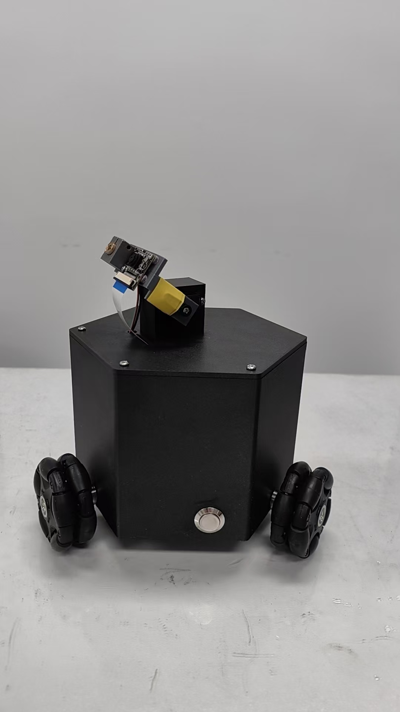
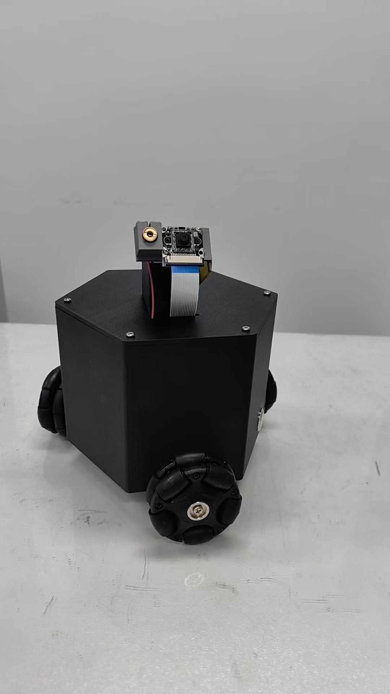
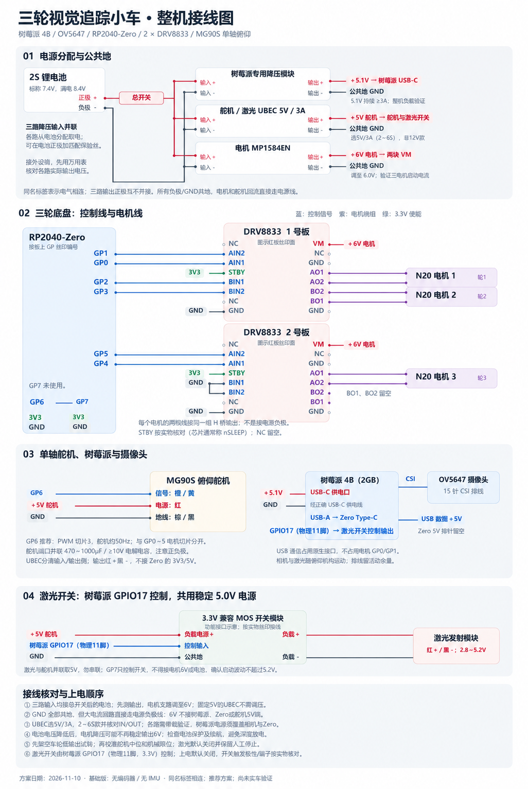
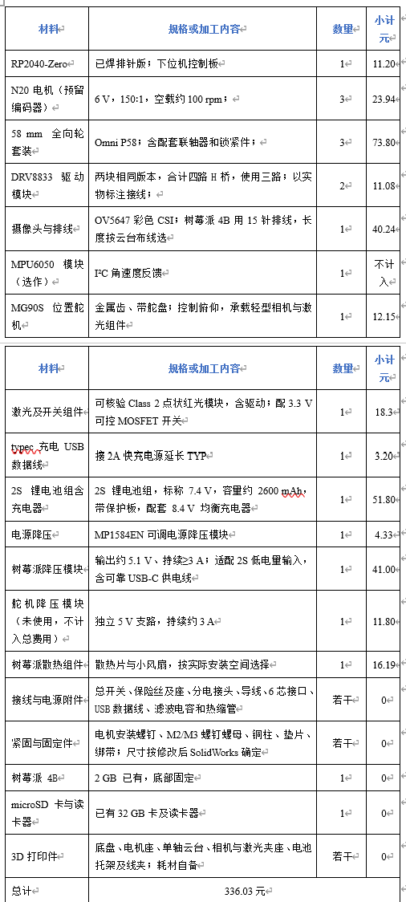

# 基于三轮全向底盘与单轴云台的 移动视觉激光追踪系统

树莓派通过 CSI 摄像头识别 ArUco 标记，使用三轮全向底盘调整水平方向，使用单轴云台调整俯仰。相机和激光模块安装在同一个云台托架上。项目包含基本功能测试、静态追踪和动态追踪三部分。

## 目录结构与项目素材

```text
.
├── 基本功能/
│   ├── control.py          # 底盘、舵机、相机和激光测试入口
│   ├── pico_control.py     # RP2040 电机控制
│   ├── vision_tracking.py  # ArUco 标记与红色光点检测
│   └── laser_control.py    # 激光 GPIO 开关与脉冲测试
├── 静态追踪/
│   ├── control.py          # 静态追踪入口及基础控制
│   ├── laser_aiming.py     # 原地旋转与俯仰追踪
│   ├── start_laser_aim.sh  # 静态追踪启动脚本
│   ├── check_system.sh    # 环境检查脚本
│   ├── tune_laser_aim.py   # 参数查看与调参工具
│   ├── pico_control.py
│   ├── vision_tracking.py
│   └── laser_control.py
├── 动态追踪/
│   ├── control.py          # 前进、停车、调用静态追踪
│   ├── start_laser_aim.sh  # 动态追踪启动脚本
│   ├── laser_aiming.py     # 动态目录内的独立实验逻辑
│   ├── check_system.sh
│   ├── tune_laser_aim.py
│   ├── pico_control.py
│   ├── vision_tracking.py
│   ├── laser_control.py
│   └── README.md
├── assets/
│   ├── outlook/           # 整机外观照片
│   ├── hardware/          # 整机接线图与物料清单
│   ├── demo/
│   │   ├── 基本功能/
│   │   ├── 静态追踪/
│   │   ├── 动态追踪/
│   │   └── 移动靶追踪/
│   └── stl/               # 3D 打印用 STEP 模型
├── QUICKREF.txt
└── README.md
```

### 整机外观

| 外观照片 1 | 外观照片 2 |
| --- | --- |
|  |  |

### 整机接线与物料

| 整机接线图 | 物料清单（BOM） |
| :---: | :---: |
| <a href="assets/hardware/wiring-diagram.png"></a> | <a href="assets/hardware/bill-of-materials.png"></a> |

点击图片可查看原图。接线图是 2026-11-10 的方案稿，图中舵机信号标为 RP2040 GP6，当前代码使用树莓派 BCM GPIO18 控制舵机。

### 测试演示

| 测试 | 视频 |
| --- | --- |
| 基本功能 · 三轮全向底盘 | [底盘动作](assets/demo/基本功能/基本功能地盘demo.mp4) |
| 基本功能 · 云台俯仰 | [舵机动作](assets/demo/基本功能/舵机demo.mp4) |
| 静态追踪 | [演示 1](assets/demo/静态追踪/静态追踪demo1.mp4) · [演示 2](assets/demo/静态追踪/静态追踪demo2.mp4) · [演示 3](assets/demo/静态追踪/静态追踪demo3.mp4) · [演示 4](assets/demo/静态追踪/静态追踪demo4.mp4) |
| 动态追踪 | [动态追踪演示](assets/demo/动态追踪/动态追踪demo.mp4) |
| 移动靶追踪 | [移动靶追踪演示](assets/demo/移动靶追踪/移动靶追踪demo.mp4) |

### 3D 打印模型

`assets/stl/` 中保存的是 STEP 源模型。切片软件需要 STL 时，可用 CAD 软件打开 STEP 文件并导出 STL。

| 零件 | 模型 |
| --- | --- |
| S1 车壳 | [S1_车壳.step](assets/stl/S1_车壳.step) |
| S2 中层板 | [S2_中层板.step](assets/stl/S2_中层板.step) |
| S3 顶盖（带舵机舱） | [S3_顶盖_带舵机舱.step](assets/stl/S3_顶盖_带舵机舱.step) |
| S4 相机与激光托架 | [S4_相机激光托架.step](assets/stl/S4_相机激光托架.step) |

## 三个部分的任务

| 部分 | 任务 |
| --- | --- |
| **基本功能** | 验证底盘的前进、后退、左右横移和双向旋转，测试云台俯仰、相机识别以及激光脉冲。也可用 `track` 联动测试底盘转向和云台俯仰。 |
| **静态追踪** | 从当前位置追踪靶面上的 ArUco 标记。底盘原地旋转以修正水平偏差，云台俯仰以修正垂直偏差。两轴以画面中心为对准基准，程序另外报告检测到的激光光点位置。激光在追踪期间常亮。 |
| **动态追踪** | 启动脚本运行 `forward-locate`，先复用基本功能让底盘向前行驶 1.5 秒，前进动作结束后再调用静态追踪脚本定位和对准标记。 |

三个目录各自包含相同的底盘、视觉和激光驱动模块。树莓派使用 Picamera2 采集 640 × 480 图像，用 OpenCV 检测 `DICT_4X4_50` 字典中的标记。底盘控制程序通过 USB 串口将 `pico_control.py` 送入 RP2040 的 MicroPython REPL 执行。

## 环境准备与启动

在 Raspberry Pi 4 上运行。接好 OV5647 CSI 摄像头、刷有 MicroPython 的 Pico/RP2040 控制板、俯仰舵机（BCM GPIO18）和激光模块（BCM GPIO17）。视觉测试使用 `DICT_4X4_50` 的 ArUco 标记，默认 ID 为 0。

在 Raspberry Pi OS 上安装 Python 依赖，并确保系统已经安装 `pigpiod`。以下命令都从项目根目录执行。

```bash
sudo apt install python3-venv python3-opencv python3-numpy python3-picamera2 \
  python3-gpiozero python3-lgpio python3-pigpio python3-serial micropython-mpremote

# 已有可用的 .venv 时，跳过创建步骤。
python3 -m venv --system-site-packages .venv
source .venv/bin/activate

pgrep -x pigpiod || sudo pigpiod
```

### 基本功能

```bash
# 读取相机画面，在终端输出检测结果
python 基本功能/control.py observe --marker-id 0

# 依次测试前进、后退、左移、右移和双向旋转，每个动作 1 秒
python 基本功能/control.py motion-test --port /dev/ttyACM0 --seconds 1

# 单独测试云台俯仰
python 基本功能/control.py tilt --start-pitch-us 1300 --pitch-us 1000

# 底盘停车后，测试单次激光脉冲与光点检测
python 基本功能/control.py laser-test --port /dev/ttyACM0 --marker-id 0

# 联动测试底盘转向与云台俯仰
python 基本功能/control.py track --port /dev/ttyACM0 --marker-id 0
```

查看全部测试参数可运行 `python 基本功能/control.py --help`。如果 Pico 枚举为其他串口，将示例中的 `/dev/ttyACM0` 换成实际设备路径。

### 静态追踪

```bash
bash 静态追踪/start_laser_aim.sh --marker-id 0
```

脚本自动选择第一个 `/dev/ttyACM*` 设备。脚本默认起始俯仰为 1050 µs，底盘旋转速度参数为 0.6。可使用 `--pitch-us` 与 `--speed` 修改这两个值。需要明确指定串口时，直接运行 Python 入口。

```bash
python 静态追踪/control.py laser-aim --port /dev/ttyACM0 --marker-id 0 --pitch-us 1050
```

### 动态追踪

```bash
bash 动态追踪/start_laser_aim.sh --marker-id 0
```

建议连接一块 Pico 供前进和追踪阶段自动选择。`--speed` 和 `--min-duty` 分别调整前进阶段的占空比上限和起转补偿，默认分别为 0.8 和 0.55。使用此启动脚本时应省略 `--port`，因为它会将该参数传给静态追踪脚本，而后者固定使用串口自动选择。

持续追踪和相机观察可按 `Ctrl+C` 结束。
